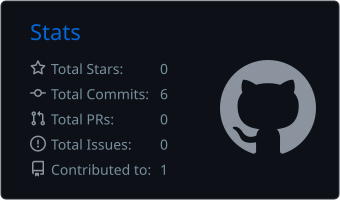

# Hi, I'm El Sayed 👋

---

### 🛠️ Technologies & Tools

---

### 📊 GitHub Stats

---

### 💻 Languages Used in My Repositories

<!-- LANGUAGES_START -->

<table>
<tr><td align="center"> CSS</td><td align="center"> JavaScript</td><td align="center"> TypeScript</td></tr>
</table>

<!-- LANGUAGES_END -->

---

### 🟩 Contributions

---

### 📬 Connect With Me

